<div align="center">

<a href="https://mmeookamy.github.io/">
  
</a>

**[mmeookamy.github.io](https://mmeookamy.github.io/)**

[English](README.md) · Français


</div>

Ma page de présentation GitHub Pages : une courte présentation (pas un CV complet), avec un
HUD holographique orange sur fond sombre, inspiré de **Mass Effect 2**.

## Ce qu'on trouve sur la page

| Section | Contenu |
|---|---|
| **Profil** | qui je suis, en quelques lignes, avec une petite fiche « dossier personnel » |
| **Missions** | les projets mis en avant |
| **Arsenal** | langages, frameworks et outils, par groupe |
| **Homelab & DevOps** | comment mes projets passent du code à la production |

La page est bilingue (FR / EN) : elle suit la langue du navigateur, et le bouton `FR` / `EN`
retient le choix.

## Fabrication

HTML, CSS et JavaScript natifs : pas de framework, pas de build, pas de CDN. Les icônes sont
des SVG intégrés.

```text
index.html          structure de la page, textes en français
src/css/style.css   thème (couleurs en haut, dans :root)
src/js/data.js      projets, stack et traductions anglaises  ← c'est ici qu'on modifie
src/js/main.js      affichage et changement de langue
src/fonts/          police style Mass Effect (titres)
src/img/            logo, bannière, cookie
```

## Mettre la page à jour

- **Ajouter un projet :** copier une entrée de `PROJECTS` dans `src/js/data.js` et remplir `fr` et `en`.
- **Ajouter une compétence :** l'ajouter au bon groupe de `STACK`, dans le même fichier.
- **Changer un texte :** le français dans `index.html` (élément avec `data-i18n="clé"`),
  l'anglais dans `TRANSLATIONS.en`, sous la même clé.
- **Changer les couleurs :** les variables en haut de `src/css/style.css`.

## Lancer en local

```bash
python -m http.server 8000
# puis ouvrir http://localhost:8000
```

Ouvrir directement `index.html` dans le navigateur marche aussi.

---

<div align="center">
<sub>Fait avec 🧡 par <a href="https://www.ookamy.fr/">Mme Ookamy</a> · <a href="https://www.ookamy.fr/contact">Me contacter</a></sub>
</div>
