<div align="center">

<a href="https://mmeookamy.github.io/">
  
</a>

**[mmeookamy.github.io](https://mmeookamy.github.io/)**

English · [Français](README.fr.md)


</div>

My GitHub Pages profile page: a short introduction (not a full résumé) with an orange
holographic HUD on a dark background, inspired by **Mass Effect 2**.

## What's on the page

| Section | Content |
|---|---|
| **Profile** | who I am, in a few lines, with a small "personnel file" card |
| **Missions** | featured projects |
| **Arsenal** | languages, frameworks and tools, by group |
| **Homelab & DevOps** | how my projects go from code to production |

The page is bilingual (FR / EN): it follows the browser language, and the `FR` / `EN`
switch remembers the choice.

## Built with

Plain HTML, CSS and JavaScript: no framework, no build step, no CDN. Icons are inline SVG.

```text
index.html          page structure, French texts
src/css/style.css   theme (colors at the top, in :root)
src/js/data.js      projects, stack and English translations  ← edit here
src/js/main.js      rendering and language switch
src/fonts/          Mass Effect style font (titles)
src/img/            logo, banner, cookie
```

## Updating the page

- **Add a project:** copy an entry of `PROJECTS` in `src/js/data.js` and fill `fr` and `en`.
- **Add a skill:** add it to the right group of `STACK` in the same file.
- **Change a text:** French in `index.html` (element with `data-i18n="key"`),
  English in `TRANSLATIONS.en` under the same key.
- **Change the colors:** the variables at the top of `src/css/style.css`.

## Run locally

```bash
python -m http.server 8000
# then open http://localhost:8000
```

Opening `index.html` directly in a browser works too.

---

<div align="center">
<sub>Made with 🧡 by <a href="https://www.ookamy.fr/">Mme Ookamy</a> · <a href="https://www.ookamy.fr/contact">Get in touch</a></sub>
</div>
